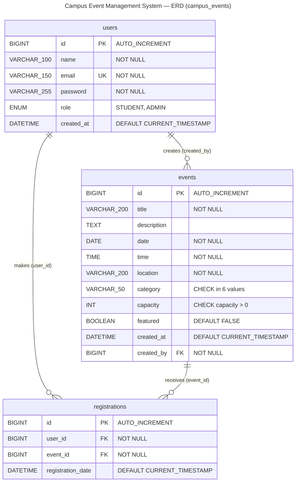

# Campus Event Management System — ERD (campus_events)

## Legend

- **PK** primary key, **FK** foreign key, **UK** unique
- `||` = exactly one, `o{` = zero or many

## Constraints

- `users.role`: ENUM (`STUDENT`, `ADMIN`)
- `events.capacity`: CHECK (`capacity > 0`) — `chk_events_capacity`
- `events.category`: CHECK in (`SEMINAR`, `WORKSHOP`, `SPORTS`, `COMPETITION`, `CONFERENCE`, `CULTURAL`) — `chk_events_category`
- `registrations`: UNIQUE (`user_id`, `event_id`) — `uq_user_event`; junction table (users M:N events)
